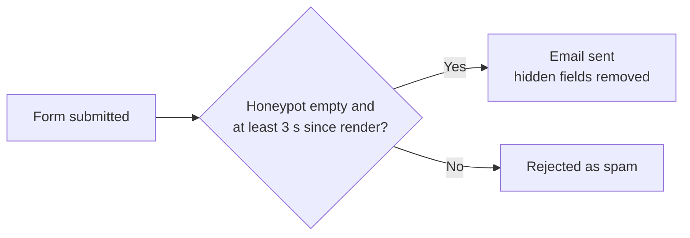

# Custom code

All custom PHP, CSS and JavaScript is stored inside WordPress, in the **WPCode** plugin. Find it under **Code Snippets** in the dashboard. No custom code is kept in files.

WPCode must stay active. If it is deactivated, everything below stops, including the mat pages' specs and the form spam protection.

## Snippets

| Snippet | Type | Runs | What it does |
|---|---|---|---|
| TMC: Mat and Accessory Content | PHP | Everywhere | Prints the sections of mat and accessory pages from the ACF fields: spec table, design option galleries, reference sites, downloads, recent projects and related items. Also the breadcrumbs, the hero badges and the summary used in cards. |
| TMC: Content Styles | CSS | Site-wide header | Styles for everything the snippets print, plus case study and blog content. Uses the Elementor colour variables. |
| TMC: Mat Finder | PHP | Everywhere | On the Mat Finder page, lists the mats whose Mat Finder category contains the clicked letter (A–F). |
| TMC: Technical Table | PHP | Everywhere | The filterable mat table on Technical Information, and the version with supplier and price on Solutions. |
| TMC: Form Spam Protection | PHP | Everywhere | Checks the hidden form fields (see below). |
| TMC: Form Auto-Replies and Redirects | PHP | Everywhere | Like the live forms: Project enquiry sends the visitor a thank-you email; Construction BOQ goes to /thank-you/ after sending. Forms are matched by their Form name. |
| TMC: Site Guide | PHP | Admin only | The read-only Site Guide page: the teal item at the top of the admin menu, above Dashboard. |

An exported copy of all snippets is in [`exports/wpcode-snippets.json`](exports/wpcode-snippets.json). It is a backup only; nothing loads it.

## How the code connects to Elementor

Elementor V4 has no shortcode widget, so the code connects in three ways:

- **Post Content slot**: the Single Mat and Single Accessory templates have a Post Content widget, and the code fills it with the page sections.
- **Paragraph with a Shortcode dynamic tag**: used for the breadcrumbs (`[tmc_breadcrumbs]`), the mat badges (`[tmc_mat_badges]`) and card summaries (`[tmc_summary words="22"]`). These paragraphs carry the `tmc-crumbs` or `tmc-badges` class.
- **An empty block with a class**: the Mat Finder fills `.tmc-finder-results`, and the technical tables fill `.tmc-tech-results`.

## Form spam protection

There are six Elementor forms: Home, Contact, Project Enquiry, ModuMat, Construction Projects and Entrance Matting Specialist. Recipients, CC and BCC match the live site; change them in each form's Email settings in Elementor. Protection works without a captcha.

Each form contains a hidden **Spam Trap** block with two fields:

| CSS ID | Rule |
|---|---|
| `tmc-hp-website` | A honeypot. It must stay empty; bots fill it in. |
| `tmc-hp-ts` | The page render time (Current Date Time tag, format `U`). A submission sent less than 3 seconds after it is rejected. |

To add a new form, copy the Spam Trap block from an existing form and keep both CSS IDs unchanged.

## Changing code

- Edit the snippet under **Code Snippets** and click **Update**. WPCode rejects a PHP error when you save, and switches off a snippet that fails later.
- WPCode runs all the "Everywhere" PHP snippets together. A `return` at the top level of one snippet stops the snippets after it, so don't use one.
- Prefix functions with `tmc_`, and escape all output.
- When you change a feature, update the "TMC: Site Guide" snippet to match.
- Before larger changes, export the snippets (Code Snippets → Tools → Export) and save the file over `docs/exports/wpcode-snippets.json`. If you change the content model in ACF, re-export it to `docs/exports/acf-export.json`.
- Tracking code belongs in Google Tag Manager, not WPCode, so that it respects the cookie banner.
- Never commit credentials, database dumps or personal data.

Administrators can edit and run PHP from the dashboard, so keep the number of administrator accounts small.
