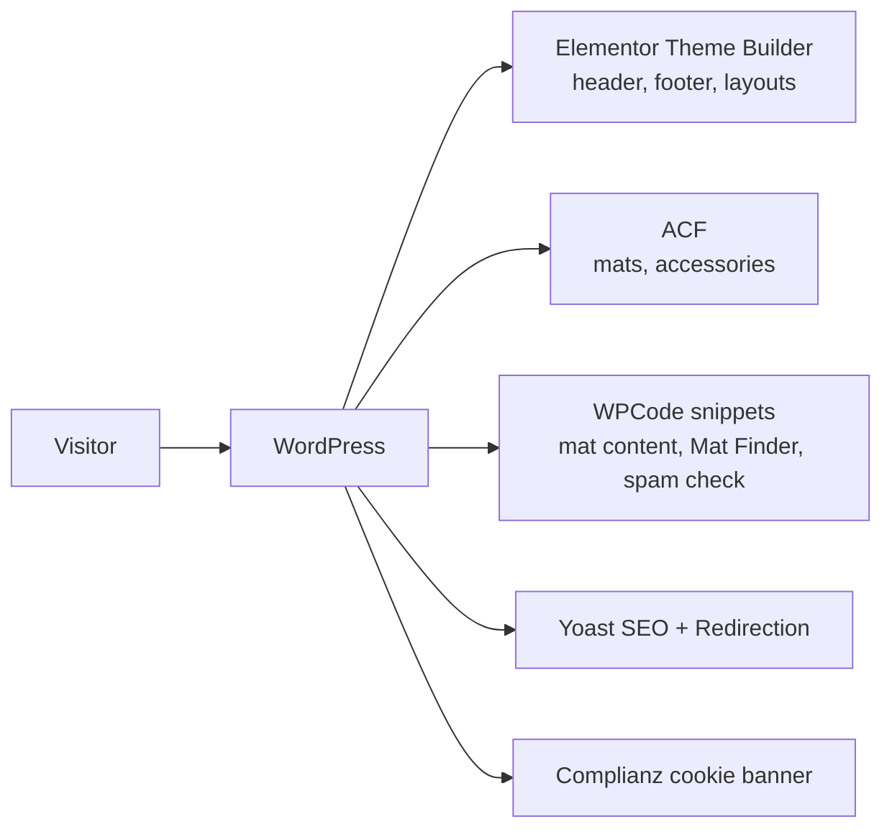

# How the site works

## Where things are managed

Everything is set in the dashboard. **Dashboard → Site Guide** shows this same map, with links and status checks.

| What | Where |
|---|---|
| Header, footer, page layouts | Templates → Theme Builder (Elementor) |
| Page content | Pages → Edit with Elementor |
| Project pages | Pages, edited in the normal editor (they use the Case Study template) |
| Mats, accessories | Their own admin menus (ACF post types) |
| Mat specs, colour galleries, reference sites, downloads | The **Mat Details** / **Accessory Details** boxes on each entry |
| Mat Finder results | Each mat's **Mat Finder category** tick boxes (A–F) |
| Technical Information and Solutions tables | Built from the Mat Details fields |
| Colours, fonts, reusable styles | Elementor global variables and classes (`tmc-*`) |
| Menus | Appearance → Menus |
| Forms: fields, recipients, subject | The form widget on each page, in Elementor |
| SEO titles, descriptions, sitemaps | Yoast SEO |
| Redirects | Tools → Redirection |
| Cookie banner | Complianz |
| Custom code | Code Snippets (WPCode), snippets named "TMC: …" |

## Content model

These are defined in ACF. An exported copy is in [`exports/acf-export.json`](exports/acf-export.json), which can be imported through ACF → Tools.

| Post type / taxonomy | Key | URLs |
|---|---|---|
| Mats | `mats` | `/mats/<slug>/`, archive `/mats/` |
| Accessories and Frames | `accessories-frames` | `/accessories-frames/<slug>/` |
| Mat Categories (on mats) | `mat-categories` | `/mat-categories/<slug>/` |

These keys and URLs are the same as on the live site.

Field groups:

- **Mat Details**: summary, use, Mat Finder category (A–F tick boxes), specifications (height, sizes, insert, water absorption, design, fire rating, wear, guarantee, lead time), design option galleries, reference sites, downloads. Supplier, cost and expected lifetime are internal: they only show on the Solutions page.
- **Accessory Details**: description, image gallery, downloads.
- **Page Options**: the *Project case study* switch, which puts a page under Projects in the breadcrumbs.

ACF free has no gallery or repeater field, so galleries and downloads are text-editor fields:

- **Galleries**: Add Media → Create Gallery.
- **Downloads**: one link per line. The link text becomes the button label.

The page sections for mats and accessories are added by code, so the post content stays empty.

## Templates

These are Theme Builder templates; the IDs are WordPress post IDs.

| Template | ID | Used for |
|---|---|---|
| Header / Footer | 70 / 71 | Entire site |
| Single Mat | 7510 | All mats |
| Single Accessory | 7511 | All accessories |
| Product Archive | 7658 | `/mats/`, `/accessories-frames/`, mat category archives |
| Case Study | 7695 | Project pages, each added to its display conditions |
| Text Page | 7763 | Logo Mats Old and other plain text pages |
| Single Post / Blog Archive / Search / 404 | 7662 / 7659 / 7660 / 7661 | Blog and system pages |

The other pages have their own Elementor layouts: Home, Products, the category pages, Mat Finder, Technical Information, Solutions, Logo Mats, ModuMat, Services, About, FAQs, Contact, Project Enquiry, Matting Matters, Projects and the landing pages.

## Good to know

- **After style changes**, clear the Elementor cache (Elementor → Tools → Clear Files & Data).
- **Modifier classes must sit above their base class.** In Elementor's class list, modifiers such as `tmc-btn-primary` have to come before `tmc-btn`.
- **New project page**: create the page, turn on *Project case study*, and add it to the Case Study template's display conditions. To list it on the Projects page, add it to that page's loop.
- **Redirects**: `/contact-us/` → `/project-enquiry-form/` and `/homepage/` → `/` (both as on live). `/clayton-cork/` and `/the-masonry/` → `/centreparcs/`, because on live both showed the Center Parcs case study; they are kept as pages but set to noindex. Old author archives and empty categories also redirect.
- **About Us** is published but not linked from the menus, as on live.
